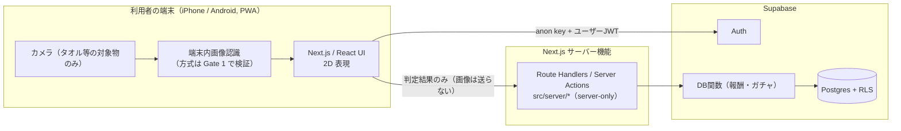
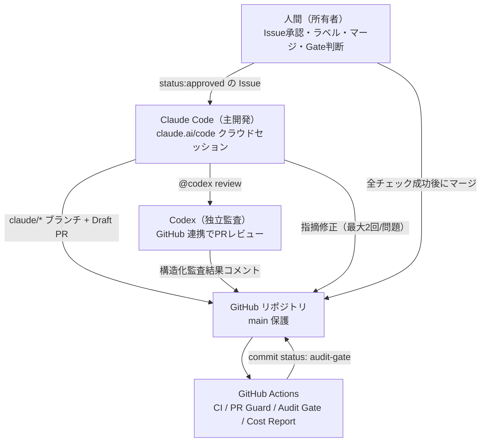

# ARCHITECTURE.md — アーキテクチャ

本書は技術構成・信頼境界・開発ハーネス構成の正本。採用ライブラリ・バージョンは、実装時点の
公式情報と既存リポジトリを確認して決め、決定は DECISIONS.md に記録する。未検証の方式を利用可能と断言しない。

## 1. アプリケーション構成（目標像）

### 確定している技術方針
- Next.js（App Router）+ React + TypeScript、Supabase（Auth / Postgres）、PWA 第一候補、すべて2D。
- 現在の骨格: Next.js 16.4.6 / React 19.3.1 / TypeScript 6.0.3（typescript-eslint の対応範囲のため 7 系は不採用）/ Vitest 5.1.0 / Node 22（D-003）。

### 信頼境界と原則
| 境界 | 原則 |
|---|---|
| 端末 → サーバー | クライアントから届く値は信頼しない。コイン数・抽選結果・付与アイテムは受け取らない |
| 画像 | 端末外に出さない。サーバーに送るのは「判定結果・時刻・モデルの版」等の最小限のメタデータのみ（DATA_HANDLING.md） |
| サーバー → DB | 原則ユーザー JWT で RLS を通す。`service_role` はサーバー専用モジュールでのみ使い、必要性を DECISIONS.md に記録 |
| 報酬・ガチャ | DB 関数または `src/server/` 内の単一トランザクションで、冪等キー付きで確定する |

### 事前登録（Gate 0）の構成（D-011）
- 事前登録データは `waitlist` スキーマに置き、Supabase の Data API（PostgREST）には公開しない。`anon` / `authenticated` には権限を与えず、
  全テーブル RLS 有効・ポリシーなし（既定拒否）。アプリ本体の `auth.users` とは関連付けない。
- Next.js のサーバー処理（`src/server/`）から PostgreSQL に直接接続する（`postgres` ドライバ 3.4.9、接続文字列はサーバー専用の環境変数）。
- 権限・RLS は `tests/db/` の結合テストで実 PostgreSQL（CI は 17 系）に対して検証する。

### 未確定（Gate ごとに決定）
- 端末内画像認識の方式・モデル（Gate 1）
- サーバー処理を Next.js と Supabase DB 関数 / Edge Functions のどちらに置くか（Gate 2）
- ホスティング先・環境分離（OPEN-7）

## 2. 環境分離

| 環境 | 用途 | 状態 |
|---|---|---|
| ローカル / CI | 開発・自動テスト（本番データ・本番キーを使わない） | 構築済み（CI） |
| 開発用 Supabase | 結合テスト | **未作成**（作成は人間承認。費用影響の確認が必要） |
| 本番 | 公開 | **未作成**（RELEASE_CHECKLIST.md） |

既存の Supabase / Vercel アカウントには他製品のプロジェクトが存在する。おふろクエストでは
それらを使わず、専用プロジェクトを人間の承認後に作成する（既存プロジェクトへの接続・変更は禁止）。

## 3. 開発ハーネス構成

### 構成要素
| 要素 | 実体 | 役割 |
|---|---|---|
| 作業規約 | `CLAUDE.md` | Claude Code の手順・禁止事項 |
| 監査規約 | `AGENTS.md` | Codex の観点・重大度・報告書式 |
| Claude 権限 | `.claude/settings.json` | 危険な MCP 操作の deny / ask、`.env` 読み取り禁止 |
| Bash ガード | `.claude/hooks/guard-bash.mjs` | 強制Push・main Push・本番デプロイ・秘密表示等を deny |
| CI | `.github/workflows/ci.yml` | typecheck / lint / test / secret-scan / policy-check / migration-check / build / npm audit |
| PR Guard | `.github/workflows/pr-guard.yml` | テスト削除・ハーネス変更に人間の承認ラベルを要求 |
| Audit Gate | `.github/workflows/audit-gate.yml` + `scripts/harness/audit-gate.mjs` | 監査結果を読み commit status を設定（マージ条件） |
| Cost Report | `.github/workflows/cost-report.yml` | 月次の実行量集計・上限超過で失敗 |
| 依存更新 | `.github/dependabot.yml` | 依存の更新PR（件数上限付き） |

### Audit Gate の仕組みと限界
- Codex のコメント投稿はそれ自体ではマージをブロックしない。そこで Audit Gate ワークフローが
  信頼できる監査者アカウント（`.github/audit-gate.json`）のコメント/レビューから `ohuro-audit` ブロックを読み、
  **PR の現在の head SHA に対する** 結果だけを採用して commit status を設定する。
- ブランチ保護で status `audit-gate / independent-audit` を必須にすると、監査未実施・Critical/High 残存・
  Medium 未判断・修正ループ上限到達の PR はマージできない。
- 判定コードは常にデフォルトブランチのものを使い、PR のコードは実行しない（`pull_request_target` の安全な使い方）。
- **限界**: 同じリポジトリ内の PR はワークフローを書き換えられるため、悪意ある変更で status を偽装する余地が残る。
  ハーネス変更には `approved:harness-change` ラベルと人間のレビューを必須にして緩和する（SECURITY.md 残存リスク）。
- **確認済み（D-008）**: Codex のボット名は `chatgpt-codex-connector[bot]`。Codex は `ohuro-audit` ブロックを出力せず、
  標準の `codex-review-state:v1` で結果を返すため、Audit Gate は両方の形式を読む（AGENTS.md）。
- Audit Gate の判定コードはデフォルトブランチのものが使われるため、判定ロジックの変更はマージ後の PR から有効になる。
