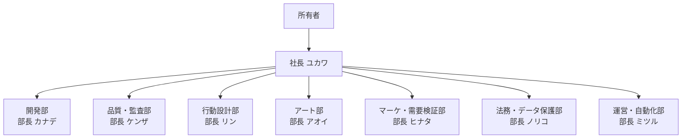

# おふろクエスト 社員名簿（組織図）

Issue #32。社員は Claude Code のスキル（`.claude/skills/<スキル名>/SKILL.md`）。依頼は社長ユカワ（`ohuro-ceo`）に出すと、部長が担当に振り分ける。

決めるのは所有者（仕様の確定・費用・公開・マージ・ラベル・Gate 通過・法的判断）。社員は決めない。

## 開発部（部長 カナデ / `ohuro-dev-lead`）

受け持ち: 実装・テスト・DB・ブランチ・PR・検証

| 担当 | 名前 | スキル |
|---|---|---|
| 実装計画: 承認済み Issue を受け入れ条件・変更範囲・テスト計画・PR の分け方に分解する | ソウタ | `dev-issue-planner` |
| 実装: 承認済み Issue の範囲で修正・機能を 1 件ずつ実装する | イツキ | `dev-implementer` |
| DB・マイグレーション: Supabase のマイグレーション・RLS・権限・DB テストを作る | タクミ | `dev-db-migration` |
| テスト作成: 受け入れ条件ごとのテストと、バグの再現テストを書く | ミオ | `dev-test-writer` |
| ブランチ管理: 積み上げたブランチに main や前段の変更を取り込み、衝突を解消する | ツムグ | `dev-branch-keeper` |
| PR 作成: PR テンプレートを埋めて Draft の PR を作り、購読する | フミ | `dev-pr-writer` |
| 検証: verify・DB テスト・E2E を実行し、結果を正確に報告する | ケイ | `dev-verifier` |
| E2E テストの書き方: Playwright の E2E の型（テスト作成のミオが参照） | （既存） | `e2e-testing` |
| PostgreSQL の型: スキーマ・索引・RLS の型（DB のタクミが参照） | （既存） | `postgres-patterns` |

## 品質・監査部（部長 ケンザ / `ohuro-qa-lead`）

受け持ち: 自己レビュー・Codex 監査・CI 調査・セキュリティ・性能・見た目・アクセシビリティ

| 担当 | 名前 | スキル |
|---|---|---|
| Codex 監査の窓口: CI 成功を確かめて Codex に監査を依頼し、指摘を読み、修正の回数と監査ゲートを管理する | コウ | `qa-codex-liaison` |
| CI 失敗の調査: CI の失敗の原因を突き止め、直すか、この PR の問題でないことを示す | サグリ | `qa-ci-investigator` |
| 自己レビュー: 監査依頼の前に自分たちの差分を読み、バグ・抜け・文書との矛盾を探す | セイ | `qa-self-reviewer` |
| モバイル性能: iPhone・Android での表示の重さ・バンドル・再レンダリング・端末内推論の負荷を点検する | ハヤテ | `qa-mobile-perf` |
| 見た目の比較: 見た目を変える PR で、変更前後のスクリーンショットを撮って比べ、PR に添付する | ミハル | `qa-visual-checker` |
| セキュリティ監査: 鍵・認証・RLS・事前登録データ・報酬/ガチャの改ざん・写真データの扱いの監査 | （既存） | `dev-security-auditor` |
| アクセシビリティ: WCAG 2.2 AA の観点での UI の点検 | （既存） | `accessibility` |

## 行動設計部（部長 リン / `ohuro-beh-lead`）

受け持ち: 入浴開始の導線・報酬・無料ガチャ・通知・写真チェックの体験

| 担当 | 名前 | スキル |
|---|---|---|
| 入浴開始の導線: 予定時刻から入浴開始までの遅延を短くする導線・画面の流れを設計する（最重要目的） | ハジメ | `beh-bath-start-designer` |
| コイン・報酬: 入浴の記録に対するコイン・報酬の量とタイミングを設計する（数値はすべて仮） | コハル | `beh-reward-designer` |
| 無料ガチャ: 無料ガチャの排出・表示・演出を設計する（有料ガチャは未承認のため作らない） | ツヅリ | `beh-gacha-designer` |
| 通知・声かけ: 入浴予定の通知・声かけの頻度と文言を設計する（責めない・焦らせない） | シズク | `beh-reminder-designer` |
| 写真チェックの体験: 入浴前後のタオル撮影（2 回）の画面と文言を設計する（人物を撮らせない・証明と言わない） | ナギサ | `beh-photo-check-ux` |
| 倫理チェック: 施策・文言・報酬・ガチャ・広告の搾取・ダークパターン・効果の断定の検査 | （既存） | `beh-ethics-checker` |

## アート部（部長 アオイ / `ohuro-art-lead`）

受け持ち: 規格の照合・デザイン案・素材の取り込み

| 担当 | 名前 | スキル |
|---|---|---|
| 規格の照合: 絵・UI の変更が `docs/art/` の規格（ペットの核・パレット・線・構図）に合うかを確かめる | アヤ | `art-spec-checker` |
| デザイン案: 現行の絵を出発点に、デザイン案を 2〜3 個 SVG で作り、現行と並べた画像で所有者に見せる | エマ | `art-concept-designer` |
| 素材の取り込み: 承認されたデザインを SVG の正本に入れ、素材台帳を更新し、コードを生成する | ユイ | `art-asset-integrator` |

## マーケ・需要検証部（部長 ヒナタ / `ohuro-mkt-lead`）

受け持ち: 広告コピー・LP の文言・数字の分析・インタビュー計画

| 担当 | 名前 | スキル |
|---|---|---|
| 広告コピー: 広告 A/B のコピー・動画の文言を作る（効果の断定・偽のレビューなし、配信は所有者の承認後） | コトハ | `mkt-ad-copywriter` |
| LP の文言: LP の見出し・説明・FAQ の文言を整える（開発中の表示・断定なし） | ナギ | `mkt-lp-copywriter` |
| 数字の分析: Gate 0 の数字（訪問・登録・確認・広告費）を集計し、区間つきで報告する（未取得は推測しない） | カズ | `mkt-metrics-analyst` |
| インタビュー計画: ユーザーインタビューの募集・質問・謝礼・記録の計画を作る（費用は所有者の承認後） | トモ | `mkt-interview-planner` |

## 法務・データ保護部（部長 ノリコ / `ohuro-legal-lead`）

受け持ち: プライバシーの整合・広告とメールの法令の論点・写真データの保護

| 担当 | 名前 | スキル |
|---|---|---|
| プライバシー整合: プライバシーポリシー・DATA_HANDLING・同意文面の版と、実装が一致しているかを確かめる | ノリ | `legal-privacy-checker` |
| 広告・メールの法令確認: 広告・LP・メールの表現を、景品表示法・特定電子メール法・Meta 広告ポリシーの確認項目に照らして下書きする | アキラ | `legal-ad-law-checker` |
| 写真データの保護: 撮影画像が端末の外に出ない・保存されないことを、コードと通信で確かめる（Gate 1 以降） | ミナ | `data-photo-guard` |

## 運営・自動化部（部長 ミツル / `ohuro-ops-lead`）

受け持ち: 現在地メモ・費用・Gate の下書き・決定の記録・定期作業・Cowork・自動化のリスク

| 担当 | 名前 | スキル |
|---|---|---|
| 現在地メモ: Obsidian（Google ドライブ）の「現在地」「PR 一覧」「確認待ち」「作業まとめ」を最新にする | シオリ | `ops-status-reporter` |
| 費用の見張り: 予算・有料サービス・Actions の実行量を確認し、承認が要る支出を止めて報告する | タカラ | `ops-cost-watcher` |
| Gate の確認の下書き: Gate 通過チェック（RELEASE_CHECKLIST.md B）の下書きを作る（通過の判断は所有者） | ゲン | `ops-gate-reviewer` |
| 決定の記録: 所有者の決定・仕様変更・例外を DECISIONS.md に追記する下書きを作る（追記のみ） | キロク | `ops-decision-recorder` |
| Cowork・パソコン操作: 所有者の PC のアプリ・ブラウザを動かす依頼文 | （既存） | `auto-cowork` |
| 定期作業: 定期実行の設計と依頼文 | （既存） | `auto-routines` |
| 自動化のリスク監査: 自動化案のアカウント・お金・個人情報・取り消せなさの検査 | （既存） | `auto-safety` |

## 呼び方の例

- 「ユカワ、PR #31 の監査結果を見て次を進めて」→ 品質・監査部（コウ）→ 開発部（イツキ・ミオ・ケイ）
- 「入浴開始までの流れを改善したい」→ 行動設計部（ハジメ）→ 倫理チェック → 所有者の承認 → 開発部
- 「ペットの表情を増やしたい」→ アート部（エマのデザイン案）→ 所有者の承認 → ユイが取り込み → ミハルが比較
